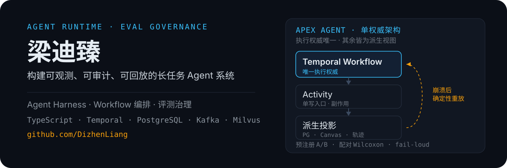

<div align="center">
  
</div>

---

## 我做什么

我构建**长任务 Agent 运行时**：把一次需求拆成可执行的工作流，交给多个 Agent 协作完成，并把每一步落成**可查询、可回放**的记录。当执行到第 87 步失败时，你能知道是谁、在哪一步、为什么失败，而不是从头再跑一遍。

核心难点不在「让模型会调用工具」，而在**长任务的正确性**——崩溃后能否确定性恢复、并发时状态以谁为准、副作用会不会重复执行。

## 代表作 · Apex-Agent

> 私有项目。以下为可公开的架构与工程事实；欢迎邮件交流或索取演示。

**单权威架构**：执行权威只有一个（Temporal Workflow），其余全部是派生视图。架构上不给双写留口子，而不是靠约定。

```text
需求 → Temporal Workflow（唯一权威）→ Activity（单写入口）
     → PostgreSQL 派生投影 → Live Canvas / 看板 / 轨迹
     失败时从 Workflow 确定性重放
```

### 工程规模

| 指标 | 数值 | 口径 |
|---|---:|---|
| 提交数 | 1,211 | `git rev-list --count HEAD`（2026-11-02） |
| 自研代码行数 | 258,283 | `src` + `tests` + `scripts`，git 跟踪 1,040 个文件，**单遍求和** |
| API 路由 | 61 | `src/app/api/**/route.ts` |
| 测试文件 | 162 | git 跟踪的 `*.test.ts / .tsx / .mts`，用例声明 990 条 |
| 守卫 | 76 条 | `scripts/run-guards.mjs` 的 GUARDS 数组（可数、无重复、目标文件全在） |
| 评测台账 | 206 行 → 81 格 | 按「任务 × 臂 × 批次」去重；重复率 154.3% |

<sub>数字由 `git rev-list` / `git ls-files` 在工作区 HEAD 复算，非估算；每个数都带口径与日期，因为**口径比数值更要紧**。</sub>

### 四条不变量，都被「会变红的守卫」钉住

| 不变量 | 怎么钉住 |
|---|---|
| **执行权威唯一** | 工作流状态由 Temporal 持久化，崩溃后可确定性重放；工作流体不读 `process.env`、只 type-only 引用 Activity |
| **写入方唯一** | 看板 / 轨迹 / 会话树都是派生投影，只能由同步 Activity 写入（TC-11 多层卡口：字面量扫描 + import 边界 + 运行时 fail-closed + worker 在场；**不是完整 AST**——动态拼出的表名正则看不见，由运行时那一层兜底，"绿"只等于"没有字面量越权写"） |
| **副作用可追踪** | 所有外部副作用集中在 Activity 层，重放时不会重复执行 |
| **边界显式** | 工具「能调用」与「被授权」是两个平面（MCP 工具面 × Eunomia 授权面） |

## 工程信条

- **断言要能变红** —— 一条永远不会失败的断言不是测试，是装饰。守卫写完必做「红证」：在 `.omc/tmp` 的源码副本上做 8 种改坏，逐条观察到变红才算过（真实源码不动）。
- **静态卡口 > 运行时约定** —— 写路径收敛在单文件，静态检查可证伪、零运行时成本。
- **fail-closed > fail-open** —— allowlist 门禁 fail-open 等于没有门禁。
- **诚实面对统计效力** —— 没有样本量支撑的结论，宁可不报，也不编造显著性。

## 实操心得 · 范式无关（换模型、换方法都不变的部分）

- **数字先定计数法，再写进任何文档**：同一范围单遍求和 258,283 行，用 `xargs wc -l | tail -1` 只剩 71,506——差 3.6 倍不是精度问题，是求和被分段截断。**台账 206 行 ≠ 206 个结论**：去重后只有 81 个格子，数行不数格会得出「全有判分、零缺口」的反向结论。
- **判断「真的在跑」只有一条判据：调用方计数**：先数 `src/` 调用方，再找触发点，两者缺一就不是在跑；`tests/` 有断言、`scripts/` 能手工触发都不算运行时接线。注释里「每 30s 在生产跑」这类句子，本仓出现过多次零调用实证——**注释只当线索，不当证据**。
- **「在 src 里」也不等于「在生产跑」，要数到第四问**：谁真的发出了触发字段。三段式 Plan-Execute-Review 有 workflow、有 worker 注册、有两个 API 分发点，但两个分发点各要一个 opt-in 字段（`framework:"plan"` / `executionMode:"orchestration"`），实测发出方为 0——唯一发 `executionMode:"orchestration"` 的前端调用打在需要另一个字段的 run 接口上 ⇒ 线上零流量，实跑单循环 `apexAgentLoop`；方法范式引擎的 `registry.json` 已提交入库，总开关却 `enabled: false`。
- **强制要下沉到写通道内部**（评测 harness 内的机制，`src/` 零调用）：「在提示词里讲道理」已被实证无效。拒收而不是提醒；分角色写权（执行者不限、规划者只写计划文档、复审者只写测试执行报告），缺陷以 `REWORK: 文件 :: 问题 :: 期望修复` 回流，复审者不改执行者的实现、只提意见。装配顺序即语义：角色段 → 裸正文（两臂逐字节同一份）→ 上游输入。

## 实操心得 · 按产品场景选范式（以及它什么时候不该用）

| 场景 | 选它 | 实测（人工判分尺 / 机器判分尺） | 不该用的信号 |
|---|---|---|---|
| 有可核验清单的契约化交付 | DP 设计方案引导 | **+0.153**（7 对 4 胜 0 负 3 平）／ **−0.167**（6 对） | 任务本身没有可核验清单 |
| 质量强约束、验收可执行 | VM 验证驱动 | −0.007（7 对）／ 恒 **0.000**（23 cell 全 0） | 分数差 100% 来自 LLM 意见时 |
| 需求模糊、要先探索 | DD 双钻 | −0.086（7 对），跨批次符号不稳 | 目前只能当噪声 |
| 汇报 / 文档类短产出 | PP 金字塔 | −0.100（6 对），轮次 25.8→30.8 | 控制臂本来就不低时，注入是纯成本 |
| 数据分析类 | CD 批评-迭代 | −0.052（6 对），但省 1,402,761 tokens／对、落盘率 13.5× | 「适配数据分析」无直接推荐证据 |

> 每个范式只有 6–7 对配对样本（预注册门槛 60 对），这些是**方向性信号**，不是可推广结论；全量池化平均差 −0.015。

## 技术栈

`TypeScript` · `Next.js` · `Temporal` · `PostgreSQL` · `Kafka` · `Milvus` · `Redis` · `Docker` · `Kubernetes` · `MCP`

## 联系

- 在线主页：[dizhenliang.github.io](https://dizhenliang.github.io/) —— 五页展开：[生产设施](https://dizhenliang.github.io/production.html) · [部署](https://dizhenliang.github.io/deploy.html) · [优化](https://dizhenliang.github.io/optimize.html) · [评测与场景选型](https://dizhenliang.github.io/eval.html) · [实操心得](https://dizhenliang.github.io/lessons.html)
- GitHub：[@DizhenLiang](https://github.com/DizhenLiang)
- 邮箱：[liangdizhen@qq.com](mailto:liangdizhen@qq.com)

<!--
  发布说明（不属于渲染内容）：
  1. 本目录 github-profile/ 即 GitHub Profile 仓库结构（README.md + assets/readme/hero.svg）。
  2. 新建同名仓库 DizhenLiang/DizhenLiang 并推送本目录内容即可生效。
  3. Apex-Agent / apex-agent-cloud 当前为私有仓库；若日后转为公开，
     可在「代表作 · Apex-Agent」标题下补上仓库与部署链接。
-->
